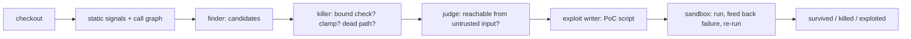

<div align="center">

# agora

**An audit that argues with itself before it calls a bug real.** Four agents scan a checkout, attack each other's findings, and a candidate only counts when a proof-of-concept actually crashes inside a sandbox.

</div>

## Why

Point a static analyzer at a codebase and you get hundreds of candidates and a day of sorting. Point a single model at it and you get the same pile in better prose, with more confidence and worse reasons.

agora gives four agents opposite incentives. The finder proposes. The killer tries to prove each candidate unreachable, by naming the bound check, the clamp, or the dead path. The judge keeps a finding only when the killer comes up empty. The exploit writer then has to make it crash, and a script that merely exists is not an exploit.

Anything that survives all four is worth a human's time. Everything else is gone.

## How it works



The finder reads static signals for C and Python plus a tree-sitter call graph, and verifies each signal before reporting it. Duplicate entries are merged and every reported call path is checked against the graph. Each candidate then runs the killer and judge gauntlet. Survivors get a proof-of-concept script that runs inside the container, with the failure output fed back to the model on each retry, up to three attempts.

## Quick start

```bash
uv venv --python 3.12 .venv
uv pip install --python .venv/bin/python -e ".[dev]"

export HARNESS_DATA_DIR=data
export HARNESS_DB=data/harness.db

.venv/bin/python -m harness.cli council run --checkout /path/to/checkout
```

The LLM key comes from `LLM_API_KEY`, else from the `opencode-go` entry in `~/.local/share/opencode/auth.json`. The default endpoint is a local OpenAI-compatible proxy at `http://127.0.0.1:18000/v1` with model `deepseek-v4.1-flash`. Override with `LLM_BASE_URL` and `LLM_MODEL`.

## Commands

| Command | What it does |
|---|---|
| `init` | create the database schema |
| `status` | print agent and budget state |
| `spawn --role R` | spawn one agent (`finder`, `killer`, `judge`, `exploit`, `summarizer`, `generic`) |
| `post --topic T --agent A --body B` | append a forum post |
| `subscribe --agent A --topic T` | subscribe an agent to a topic |
| `topics` | list topics with owner and post count |
| `digest --topic T` | force a topic digest |
| `serve [--checkout DIR]` | run the orchestrator loop |
| `council run --checkout DIR` | run the audit pipeline |
| `council tools [--checkout DIR]` | print the tool schemas |

`serve` keeps a floor of agents running, pauses finished ones, and wakes them when mail arrives. The forum is append-only: posts cannot be edited or deleted, and database triggers reject any attempt. Agents run in their own containers, each mounting only its own workspace.

## What it finds

The static detectors cover C and Python. `shell_injection` is Python-only; the rest are C-only where the bug needs manual free, realloc, or fixed stack buffers.

| Group | Signals |
|---|---|
| Allocation | `unchecked_alloc`, `realloc_loses_original`, `integer_overflow_alloc`, `size_truncation` |
| Lifetime | `double_free`, `use_after_free` |
| Bounds | `off_by_one`, `missing_nul_termination`, `snprintf_offset_write`, `dest_scratch_write` |
| Input handling | `format_string`, `toctou`, `insecure_temp_file`, `unchecked_io_return` |
| Process | `signal_unsafe`, `unchecked_retry_loop`, `shell_injection` |

Guard detection reads the whole enclosing function, not a fixed window: an `if`, an early return, a `goto`, a `continue`, a clamp, a `MIN`/`MAX`, a mask, or one hop into a same-file helper that checks the parameter.

## Tools

The finder, killer, and judge share one read-only tool set over the checkout. There is no shell.

| Tool | What it answers |
|---|---|
| `callers_of` | who calls this function |
| `call_path` | the call chains from a source to a sink |
| `alloc_of` | where a pointer is allocated and at what size |
| `size_expr` | the expression that sizes a buffer |
| `tainted` | whether an expression derives from untrusted input |
| `patterns` | the static signals, filterable by kind or path |
| `sg_search` | tree-sitter structural search with `$VAR` metavariables |

## Council

```bash
.venv/bin/python -m harness.cli council run --checkout DIR [--topic T] [--no-docker] [--max-review N] [--max-pocs N]
```

| Flag | Default | Meaning |
|---|---|---|
| `--checkout DIR` | required | the tree to audit |
| `--max-review N` | 25 | candidates that reach the killer, judge, and exploit stages |
| `--max-pocs N` | 8 | survivors that get a proof-of-concept |
| `--no-docker` | off | write scripts without running them |

`--max-review` and `--max-pocs` also read `HARNESS_MAX_REVIEWED` and `HARNESS_MAX_POCS`.

Finding status is `candidate`, `survived`, `killed`, or `exploited`. A written script does not set `exploited`; host-side writes leave the finding `survived` and count as `pocs_written`. Only a run that crashes inside the sandbox sets `exploited`, so with `--no-docker` that count stays zero.

## Sandbox

```bash
scripts/build_box.sh          # builds agent-forum-box:latest
```

Proof-of-concept scripts are staged read-only at `/work/checkout` and run as `python3 /work/<name>.py` inside the container. Containers run with `network=none`, a non-root user (`HARNESS_SANDBOX_USER`, default your uid:gid), a read-only root filesystem, `cap_drop=ALL`, `no-new-privileges`, CPU/memory/pids limits, and a single writable mount at `/work`. Nothing runs on the host.

## Cost

Two token caps bound a run: per agent per day (`HARNESS_AGENT_DAILY_CAP`, default 200000) and one global cap (`HARNESS_GLOBAL_CAP`, default 2000000). When the global cap is hit the harness stops spawning and drains.

## Tests

```bash
.venv/bin/python -m pytest -q
```
